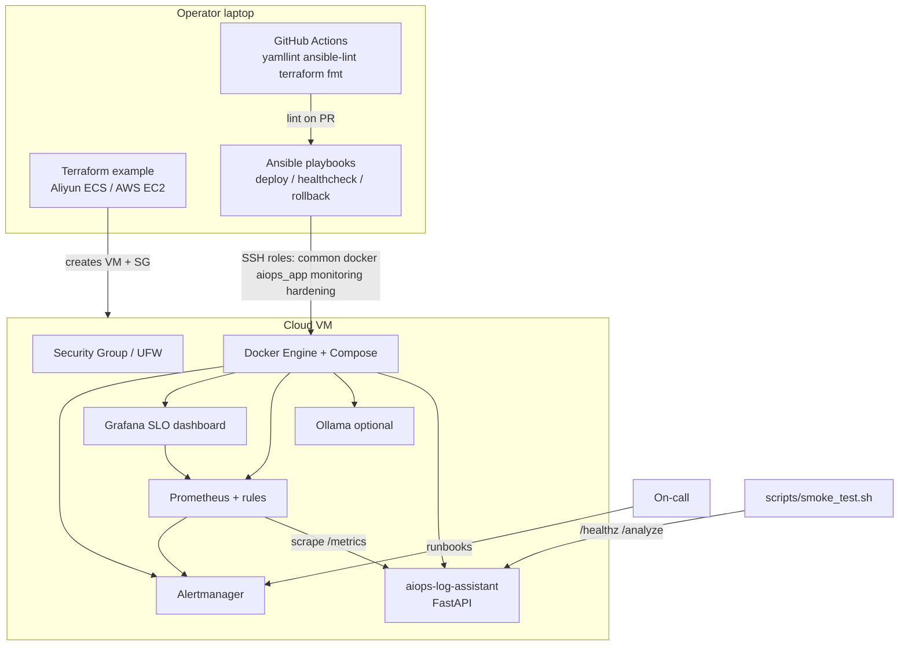

# Architecture

This repository is the **cloud delivery / ops** companion to
[`aiops-log-assistant`](https://github.com/Woo404/aiops-log-assistant).

## Deploy flow

1. **Provision** (optional): `terraform apply` in `terraform/aliyun` or `terraform/aws` → public IP.
2. **Inventory**: copy `ansible/inventory/*.example.ini` → set `ansible_host`.
3. **Deploy**: `ansible-playbook ... playbooks/deploy.yml` runs roles in order:
   `common` → `docker` → `aiops_app` → `monitoring` → `hardening`.
4. **Verify**: `playbooks/healthcheck.yml` or `scripts/smoke_test.sh`.
5. **Incident**: follow `runbooks/*`; rollback via `playbooks/rollback.yml`.

## JD skill mapping (learning)

| Theme | Where in this repo |
|-------|--------------------|
| Alibaba Cloud / AWS | `terraform/aliyun`, `terraform/aws`, inventory examples |
| Ansible | `ansible/roles/*`, playbooks |
| CI/CD | `.github/workflows/ci.yml` |
| Monitoring / SLO | `monitoring/`, Grafana dashboard JSON |
| Incident response | `runbooks/` |
| Responsible AI | sibling app redaction + `runbooks/llm-unavailable*` |
